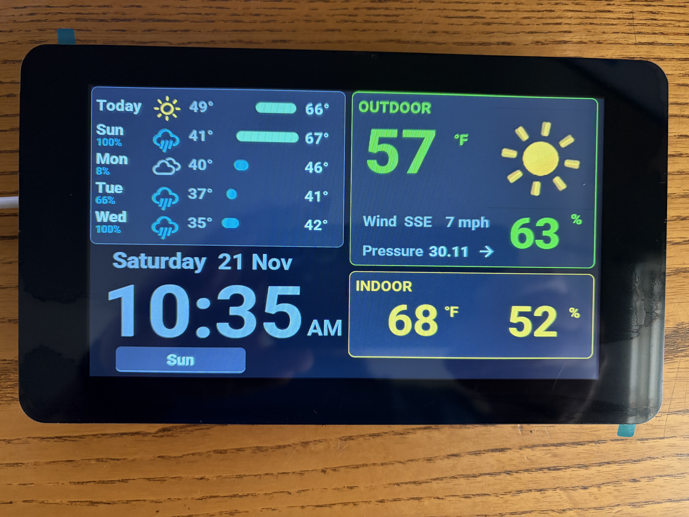
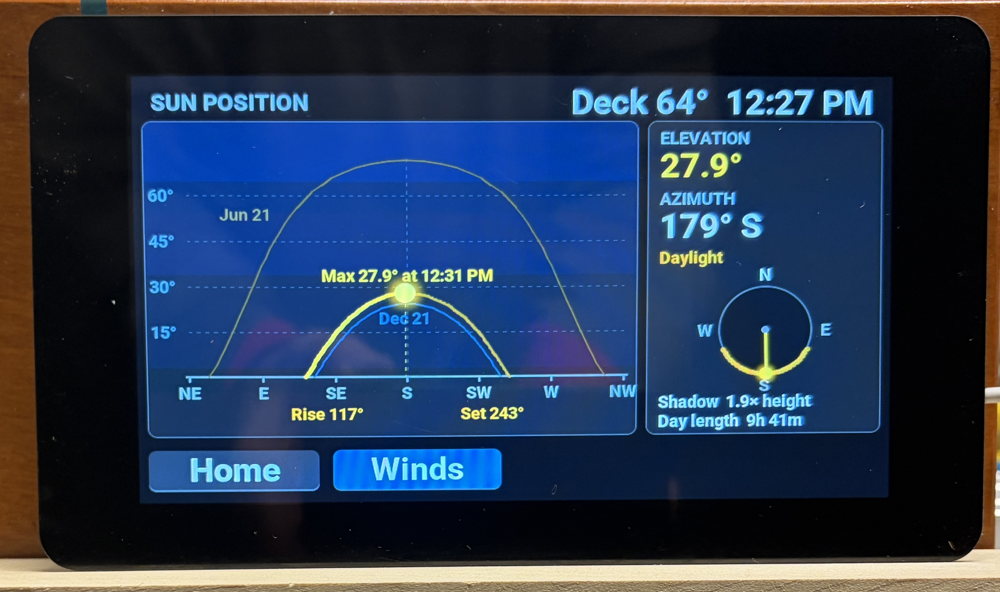

# Mancave Weather Screen

An [ESPHome](https://esphome.io) + LVGL v9 weather display by **KBW Designs**. It shows indoor and outdoor conditions, animated weather icons, and a forecast box that rotates through a 5-day forecast, the next 4 hours, and a sun & moon summary. A separate Sun page charts the sun's path, has a sun-path compass, and counts down to sunrise or sunset.

Built for the **Waveshare ESP32-S3-Touch-LCD-7 Rev 1.2** (ESP32-S3N16R8, 800×480 touch screen).

## Features

- Boot splash with the KBW Designs logo, then the main page
- Animated weather icons (Meteocons fill frames) for the current condition and the forecast
- Main page clock and date, synced from Home Assistant
- Outdoor temperature, humidity, pressure (with a rising/falling trend), and wind
- Indoor temperature and humidity
- Event rain and rain rate from an Ecowitt GW1100B, shown only while event rain is greater than zero
- Forecast box that rotates every 15 seconds:
  - **5-day:** day name, condition, high/low, and daily precip chance
  - **Hourly:** the next 4 hours with time, condition, temperature, and precip chance
  - **Sun & moon:** sunrise, sunset, solar noon, day length, and moon phase
- Sun page with a sky chart of today's path plus the June 21 and December 21 paths, live elevation and azimuth, a compass with a daylight arc, shadow length, day length, and a countdown during the last hour before sunrise or sunset
- Hourly winds page (next 4 hours)
- Sunrise, sunset, and solar noon times come from Home Assistant's `sun.sun` entity, so they follow the elevation set in HA

Temperatures are in °F, wind is in mph, and rain is in inches, as written in this config.
## Screens

## Hardware

- Waveshare ESP32-S3-Touch-LCD-7 Rev 1.2
- ESP32-S3N16R8 (16 MB flash, 8 MB octal PSRAM)
- 800×480 MIPI RGB display with GT911 touch

## Software

This config was compiled with **ESPHome 2026.10.x** (LVGL v9). Use that series or newer.

## Location

The Sun page works out the sun path on the device, so it needs your location. Set `latitude` and `longitude` in the `substitutions:` block at the top of `mancave-weather-screen.yaml` (decimal degrees, west longitude negative). Leave them at `0.0` until you fill in your own. Sunrise, sunset, and solar noon *times* still come from Home Assistant (`sun.sun`), including your HA elevation setting.

## Home Assistant entities

Edit the `ha_*` lines in the `substitutions:` block at the top of `mancave-weather-screen.yaml` so they match your own entity IDs. The defaults below are from this setup (BLE indoor sensor, deck temperature, Ecowitt GW1100B, OpenWeatherMap, and a few template sensors). The HA [Sun](https://www.home-assistant.io/integrations/sun/) and [Moon](https://www.home-assistant.io/integrations/moon/) integrations need to be enabled.

**Time**

- Home Assistant time (ESPHome `time.homeassistant`, no substitution)

**Indoor**

- `ha_indoor_temp` — `sensor.mancave_ble_temperature`
- `ha_indoor_humidity` — `sensor.mancave_ble_humidity`

**Outdoor / deck**

- `ha_deck_temp` — `sensor.deck_temperature_temperature`
- `ha_deck_humidity` — `sensor.deck_temperature_humidity`

**Ecowitt rain / pressure**

- `ha_pressure` — `sensor.gw1100b_relative_pressure`
- `ha_event_rain` — `sensor.gw1100b_event_rain`
- `ha_rain_rate` — `sensor.gw1100b_rain_rate`

**Current weather**

- `ha_wind_speed` — `sensor.current_wind_speed`
- `ha_wind_direction` — `sensor.current_wind_direction`
- `ha_condition` — `sensor.openweathermap_condition`

**5-day forecast**

- `ha_forecast_day_0_low` … `ha_forecast_day_4_low`
- `ha_forecast_day_0_high` … `ha_forecast_day_4_high`
- `ha_forecast_day_0_condition` … `ha_forecast_day_4_condition`

**Hourly wind**

- `ha_forecast_hour_0_wind_speed` … `ha_forecast_hour_3_wind_speed`
- `ha_forecast_hour_0_wind_direction` … `ha_forecast_hour_3_wind_direction`

**Sun and moon**

- `ha_sun` — `sun.sun` (state, plus attributes `next_rising`, `next_setting`, and `next_noon`)
- `ha_moon` — `sensor.moon`

**Template sensors**

- `ha_hourly_4h` — `sensor.mancave_hourly_4h`, next 4 hours as `epoch|label|temp|condition|precip%;...`. A ready-to-paste template is in [`ha-templates.yaml`](ha-templates.yaml). It reads `sensor.weather_hourly_forecast`. Paste the `- sensor:` block under your existing `template:` key in `configuration.yaml` (or your templates file), then reload **Developer Tools → YAML → Template Entities**.
- `ha_daily_precip` — `sensor.mancave_daily_precip`, daily precip chances in the format `p0|p1|p2|p3|p4`. This one is not in `ha-templates.yaml`; you will need a matching template (or another sensor that produces that same state).

The `forecast_day_*`, `forecast_hour_*`, `sensor.current_wind_*`, and `sensor.weather_hourly_forecast` entities also need to exist in Home Assistant (for example from OpenWeatherMap forecast templates). They are not created by `ha-templates.yaml`.

## Setup

1. Put this folder in your ESPHome config directory, or open the YAML from the ESPHome dashboard.
2. Copy [`secrets.example.yaml`](secrets.example.yaml) to `secrets.yaml` **or**, in the ESPHome dashboard, click **Secrets** (top right) and paste the same keys there. ESPHome uses the dashboard Secrets file, not Home Assistant's main `secrets.yaml`.
3. Fill in:
   - `wifi_ssid` / `wifi_password`
   - `mancave_weather_api_key` — API encryption key for this device
   - `mancave_weather_ota_password` — OTA password for this device
4. In the `substitutions:` block at the top of the YAML, set your `latitude` and `longitude`, and edit the `ha_*` entity IDs to match your system. Add the template sensor from `ha-templates.yaml`, and make sure the other entities above exist.
5. The first install has to be over USB. After that, Wi-Fi OTA is fine.
6. In Home Assistant, adopt the device when it appears. The API encryption key in Secrets must match the one this device was flashed with.

Do not commit `secrets.yaml`. It is listed in `.gitignore`.

## Fonts and icons

- [Weather Icons](https://github.com/erikflowers/weather-icons) (`fonts/weathericons-regular-webfont.ttf`) — SIL Open Font License 1.1
- [Material Design Icons](https://github.com/Templarian/MaterialDesign-Webfont) (`fonts/materialdesignicons-webfont.ttf`) — Apache License 2.0
- [Roboto](https://fonts.google.com/specimen/Roboto) (Google Fonts, fetched at compile time; nothing to copy) — Apache License 2.0
- Animated condition frames in `fonts/weather_frames/` are Meteocons fill icons, packaged as PNG frames

## Credit

**KBW Designs**
